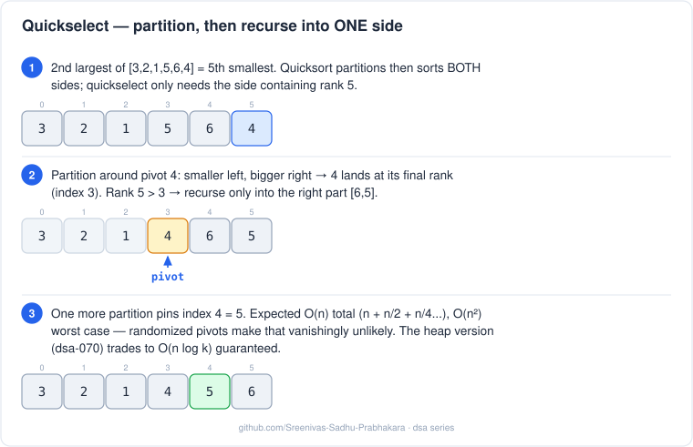

# K-th Largest via Quickselect

> Striver SDE Sheet 150 · Day 22 Mixed — quicksort that recurses into only one side: random pivots make the expected cost linear. Go, stdlib only, tested.

## Problem

The k-th largest element of an unsorted array — third appearance of this problem on the sheet, this time demanding the average-O(n) answer (heap #070 was O(n log k), stream #148 incremental).

## Approach

Quickselect: partition around a pivot (Lomuto — everything smaller swapped left, pivot dropped into its final sorted slot), then recurse *only* into the side containing the target index (k-th largest = index n−k ascending). Discarding half the work each round gives the n + n/2 + n/4 + … = O(n) expected total; the **random** pivot is load-bearing, since a fixed pivot lets adversarial input force O(n²). Working on a copy keeps the caller's slice unscrambled. A property test cross-checks against sorting over hundreds of (input, k) pairs — the right way to test a randomized algorithm.

**Complexity:** expected O(n), worst O(n²) (randomization makes it vanishingly unlikely); O(n) for the copy.

## Visual walkthrough

Read the picture top to bottom — each numbered frame is one moment of the algorithm
running on this repo's test example.

## Run

    go test ./...   # verify
    go run .        # demo

---

One of 191 repos solving Striver's SDE Sheet in Go — stdlib only, one problem per repo, every solution tested. Browse the set: [`dsa-*` repos](https://github.com/Sreenivas-Sadhu-Prabhakara?tab=repositories&q=dsa-&type=source).
